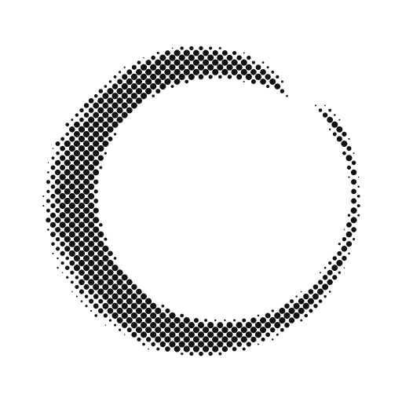
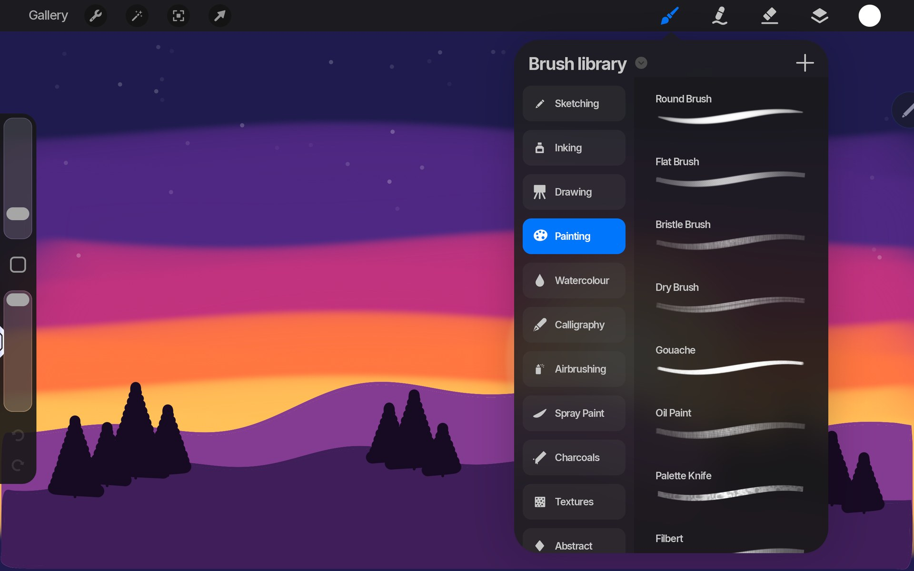
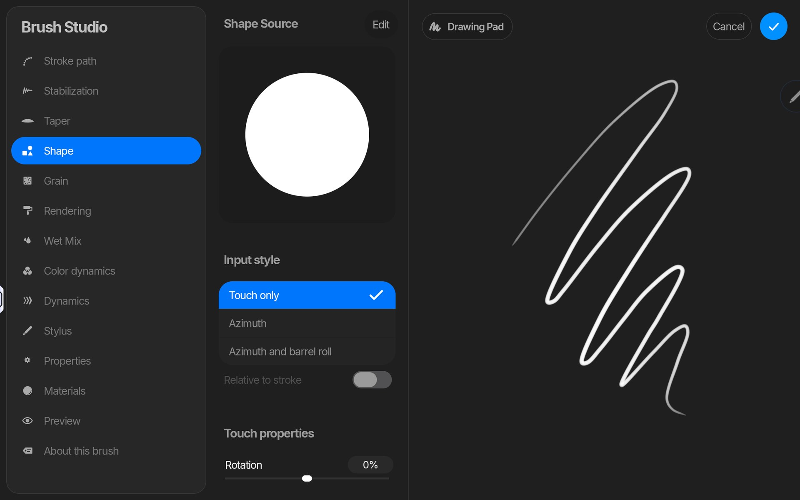
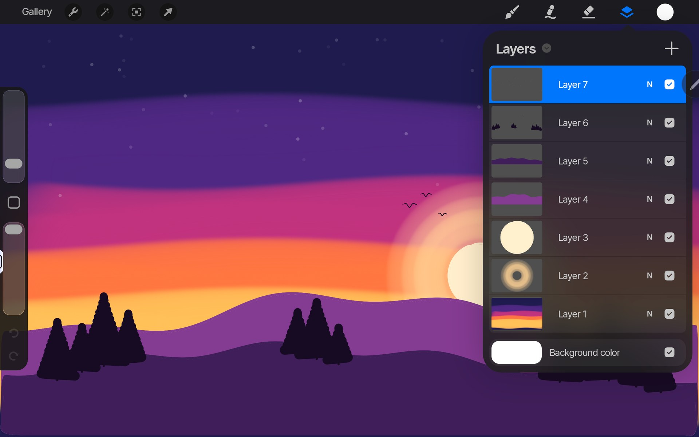
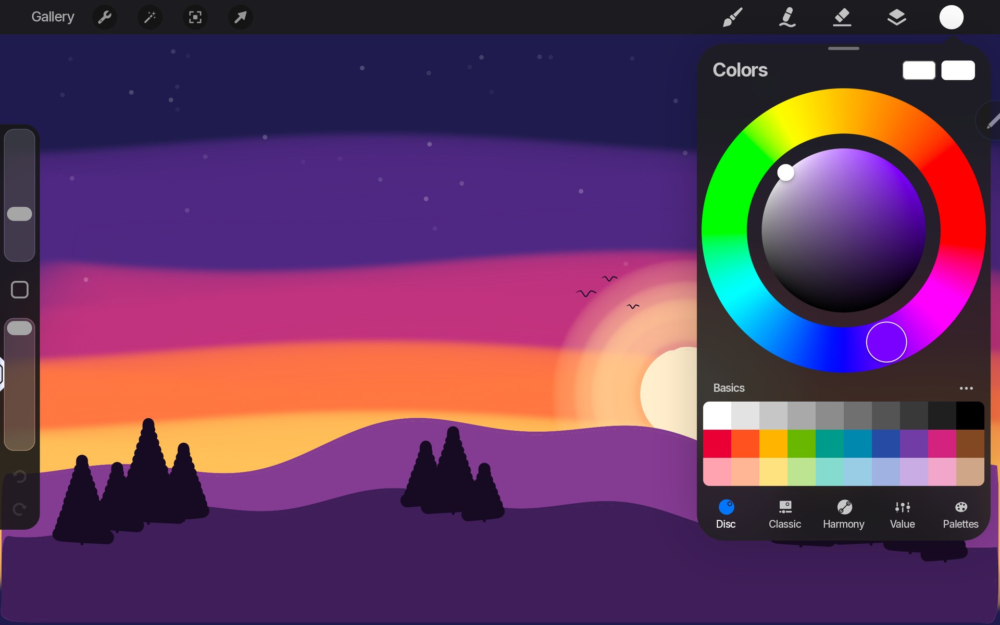
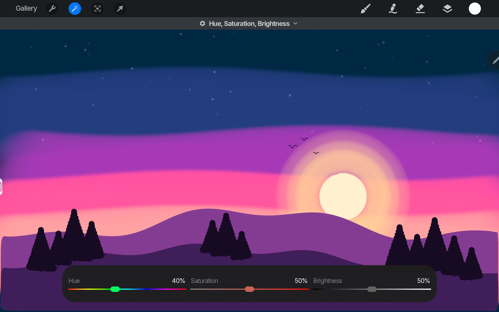
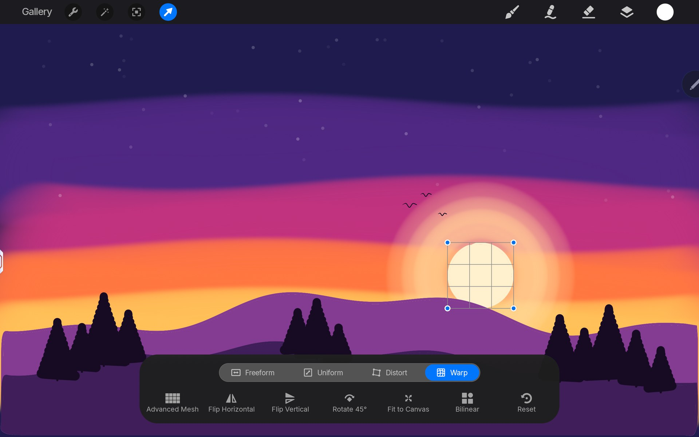

<div align="center">

<picture>
  <source media="(prefers-color-scheme: dark)" srcset="assets/brand/sumi-mark-inverse.svg" />
  
</picture>

<h1>Sumi</h1>

<p><strong>A digital painting studio for Linux and Windows, written in Rust.</strong></p>

<p>
  Built on <a href="https://github.com/artcraft-android/procraft">ProCraft</a> — custom Rust painting engine, GPU compositing in <code>wgpu</code>, and an <code>egui</code> desktop workspace (in alpha).
</p>

<p>
  <a href="https://github.com/mafuzyk/sumi/releases"></a>
  <a href="https://github.com/mafuzyk/sumi/actions/workflows/release.yml"></a>
  <a href="https://aur.archlinux.org/packages/sumi-bin"></a>
  <a href="LICENSE-GPL-3.0"></a>
</p>


<p><em><em>Dusk</em>, painted from a blank canvas in an earlier tablet build of Sumi (historical interface capture; v0.1.2 targets desktop). Recorded in <a href="docs/images/demo.webp">demo.webp</a>.</em></p>

</div>

> [!NOTE]
> **`0.1.2` is the current desktop alpha** for Linux and Windows ([`CHANGELOG.md`](CHANGELOG.md)). macOS has source support without published packages yet. Artwork files saved before the Sumi rename (`.procraft`) continue to open via [`crates/core/src/legacy.rs`](crates/core/src/legacy.rs).

---

<h2 align="center">Installation</h2>

```sh
# Arch Linux (prebuilt binary on AUR)
paru -S sumi-bin

# NixOS / Nix flakes (x86_64-linux & aarch64-linux)
nix run github:mafuzyk/sumi
```

Prebuilt installers and portable archives are published on [Releases](https://github.com/mafuzyk/sumi/releases):

- **Linux (`x86_64`):** `.AppImage` (glibc >= 2.35), `.deb` (Debian/Ubuntu), and `.tar.gz`
- **Windows (`x64` & `arm64`):** `.msi` installer and portable `.zip`

<details>
<summary>Runtime dependencies, building from source, packaging scripts &amp; 0.1.2 highlights</summary>

### System media & audio tools

- **Video / animation / PDF import:** `ffmpeg` and Poppler `pdftoppm` (`nix run` bundles both; `.deb` recommends them; AUR lists them in `optdepends`). Sumi prompts with install instructions if one is missing.
- **Audio feedback:** `pw-play`/`pw-cat`, `paplay`/`pacat`, or `aplay` on Linux (`pipewire-audio` / `libpulse` / `alsa-utils`).
- **GPU backend:** Vulkan (or OpenGL/EGL fallback on Linux via Mesa), Direct3D 12 or Vulkan on Windows, X11 or Wayland on Linux.

### Build from source

Requires Rust >= 1.95 (`edition = 2024`). CLIP STUDIO PAINT / Krita support (`crates/clip-core`) is vendored directly in the tree, so a fresh clone builds without extra checkouts:

```sh
cargo build --release -p sumi-desktop   # target/release/sumi
cargo run --release -p sumi-desktop
cargo test --workspace
```

### Packaging scripts

- **Windows:** `pwsh packaging/windows/package.ps1` (MSVC + WiX v5)
- **Linux:** `packaging/linux/package.sh` (`nfpm` for `.deb`, `appimagetool` for `.AppImage`)
- **AUR:** [`packaging/aur/PKGBUILD`](packaging/aur/PKGBUILD)

### What improved in `v0.1.2`

- Portal-free in-window file and folder choosers on Linux across imports, exports, brush sources, fonts, plugins, and gallery sharing, with safe filename/extension overwrite confirmation.
- Wall-clock `1×` (30 fps) and multi-speed time-lapse replay without redraw drift.

</details>

---

<h2 align="center">Screenshots</h2>

<div align="center">

<table>
  <tr>
    <td align="center" width="50%">
      
      <br />
      <sub><b>Brush library &amp; categories</b></sub>
    </td>
    <td align="center" width="50%">
      
      <br />
      <sub><b>Brush Studio &amp; live test pad</b></sub>
    </td>
  </tr>
  <tr>
    <td align="center" width="50%">
      
      <br />
      <sub><b>Layers, thumbnails &amp; 27 blend modes</b></sub>
    </td>
    <td align="center" width="50%">
      
      <br />
      <sub><b>Disc, classic, harmony, value &amp; palettes</b></sub>
    </td>
  </tr>
</table>

</div>

<details>
<summary>More workspace views: Adjustments &amp; Warp/Distort transform</summary>

<div align="center">

<table>
  <tr>
    <td align="center" width="50%">
      
      <br />
      <sub><b>Hue, saturation &amp; brightness adjustments</b></sub>
    </td>
    <td align="center" width="50%">
      
      <br />
      <sub><b>Freeform, uniform, distort &amp; mesh warp transforms</b></sub>
    </td>
  </tr>
</table>

</div>

</details>

---

## Studio capabilities

- **Brushes:** pressure and stylus tilt controls, custom shape and grain textures, stabilization, taper, wet colour mixing, colour dynamics, and interactive editing in **Brush Studio**.
- **Layers & memory:** 27 blend modes, per-layer opacity, alpha lock, clipping masks, layer masks, and nested groups — layers outside the active GPU working set stay compressed until touched.
- **Colour:** disc, classic, harmony, and value pickers, custom swatch palettes, eyedropper, and ColourDrop flood fill by dragging a swatch onto the canvas.
- **Selection & transform:** automatic, freehand, rectangle, ellipse, and polyline selection tools (add, remove, invert, feather) paired with freeform, uniform, distort, and warp transforms with snapping.
- **Adjustments & effects:** hue/saturation/brightness, colour balance, curves, gradient map, Gaussian/motion/perspective blur, noise, sharpen, bloom, glitch, halftone, chromatic aberration, liquify, and clone — applied to a layer or painted selectively with a brush.
- **Guides & typography:** 2D grid, isometric, perspective, and symmetry drawing guides, native text tool, and a floating reference image window.
- **Animation & time-lapse:** Animation Assist, Page Assist, background time-lapse recording with `30 fps` wall-clock replay and timeline seeking, plus `GIF`, `APNG`, `MP4`, and `HEVC` export.
- **3D painting:** load `OBJ`, `USD`, and `USDZ` models, paint directly onto 3D meshes or project through view space with environment lighting, and export textured `OBJ` / `USDZ` / maps.
- **Files & plugins:** gallery thumbnails and artwork stacks; imports `.sumi`, `.procraft`, `PSD`, `CLIP STUDIO` (`.clip`), `Krita` (`.kra`), `PDF`, and standard rasters; exports `.sumi`, `PSD`, `PDF`, layered `PDF`, `PNG`, `JPEG`, `TIFF`, `CLIP STUDIO`, and `Krita`. Extensible via `.sumi-plugin` bundles containing `WGSL` shaders or sandboxed WebAssembly modules under *Prefs › Plugins*.

---

## Architecture & safety

| Crate | Responsibility |
| --- | --- |
| `crates/engine` | Document model, brush kernels, stroke geometry, compressed tile storage |
| `crates/gpu` | `wgpu` rendering pipeline, display compositing, shader filters |
| `crates/core` | Canvas session orchestration, tools, gallery management, multi-format exports |
| `crates/sumi-clip` | High-level `CLIP STUDIO` and `Krita` document reading and writing |
| `crates/clip-core` | Vendored low-level `.clip` / `.kra` parser (`GPL-3.0-or-later`) |
| `desktop` | Cross-platform `egui` desktop UI, in-window file choosers, audio/video bridges |

The workspace enforces `#![deny(unsafe_code)]` (`unsafe_code = "deny"`) alongside zero-panic clippy rules (`unwrap_used`, `expect_used`, `panic`, and `indexing_slicing = "deny"` outside tests).

---

## Documentation

- [`CHANGELOG.md`](CHANGELOG.md) — desktop release notes (`0.1.0` – `0.1.2`)
- [`docs/plugins.md`](docs/plugins.md) — `.sumi-plugin` specification, filter hooks, and examples in [`plugins/`](plugins/)
- [`docs/icons/STYLE_GUIDE.md`](docs/icons/STYLE_GUIDE.md) — icon grid and stroke rules
- [`ATTRIBUTION.md`](ATTRIBUTION.md) — asset authors, test fixtures, and upstream credits

---

## License

Sumi is released under the [GNU General Public License v3.0 or later](LICENSE-GPL-3.0) (`GPL-3.0-or-later`).

Code and assets predating the Sumi integration remain available under either the [MIT License](LICENSE-MIT) or the [Apache License 2.0](LICENSE-APACHE) at your option; see [`NOTICE`](NOTICE) and [`ATTRIBUTION.md`](ATTRIBUTION.md). Bundled components include the Inter typeface (`OFL-1.1`), Lucide icons (`ISC` / `MIT`), Poly Haven lighting environments (`CC0`), and Björn Ottosson's Okhsl implementation (`MIT`), alongside third-party crate notices listed in [`desktop/licenses.txt`](desktop/licenses.txt) (also viewable under *Help › Licences*). `crates/clip-core` is `GPL-3.0-or-later`, so redistributing binaries built from this workspace requires providing the corresponding combined source.
