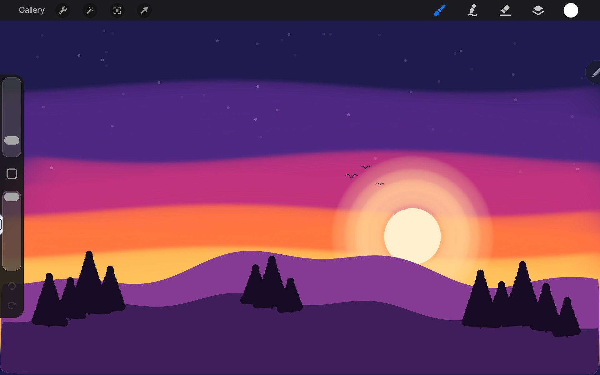

# Sumi

Sumi is a painting app for Linux, Windows and macOS. The engine and the wgpu renderer are written in
Rust, and the interface is drawn with egui.

0.1.0 is the first desktop release, for Linux, Windows and macOS.



*Dusk*, painted from a blank canvas in an earlier tablet build of Sumi. This is a historical
interface capture; the current release is desktop-only. The session is recorded in
[demo.webp](docs/images/demo.webp).

## Features

- **Brushes.** Pen pressure, tilt controls, shape and grain sources, stabilization, taper, wet mix and colour dynamics, all edited in the Brush Studio and kept in the brush library.
- **Layers.** 27 blend modes, opacity, alpha lock, clipping masks, layer masks and groups. Layers past what the GPU holds are kept compressed until they are needed.
- **Colour.** Disc, classic, harmony and value pickers, palettes, an eyedropper, and filling by dragging a colour onto the canvas.
- **Selection and transform.** Automatic, freehand, rectangle, ellipse and polyline selections with add, remove, invert and feather; freeform, uniform, distort and warp transforms with snapping.
- **Adjustments.** Hue, saturation and brightness, colour balance, curves, gradient map, Gaussian, motion and perspective blur, noise, sharpen, bloom, glitch, halftone, chromatic aberration, liquify and clone, applied to a layer or painted on with the brush.
- **Guides and text.** 2D grid, isometric, perspective and symmetry guides, a text tool, and a reference window.
- **Animation and pages.** Animation Assist and Page Assist, time-lapse recording and replay, and GIF, APNG, MP4 and HEVC export.
- **3D.** OBJ, USD and USDZ models, painting on the mesh or through it, lighting and environments, and OBJ, USDZ and texture export.
- **Gallery and files.** Artworks as thumbnails and stacks, new-canvas presets and import; opens `.sumi`, PSD, CLIP STUDIO, Krita, PDF and image files, and exports `.sumi`, PSD, PDF, PNG, JPEG, TIFF, CLIP STUDIO, Krita and layered PDFs.
- **Plugins.** `.sumi-plugin` files holding WGSL filters or sandboxed WebAssembly, imported from Prefs › Plugins.

Artwork files saved before the Sumi rename (`.procraft`) still open; the compatibility constants
are in `crates/core/src/legacy.rs`.

## Install

### Windows

[Releases](https://github.com/mafuzyk/sumi/releases) has an `.msi` installer and a portable
`.zip`, for x64 and arm64.

### Linux

The release page has an `.AppImage`, a `.deb` and a `.tar.gz`. The AppImage needs glibc 2.35 or
newer; the `.deb` is for Debian, Ubuntu and their derivatives.

- **Arch (AUR):** `yay -S sumi-bin`.
- **Nix:** `nix run github:mafuzyk/sumi` to start it, `nix build github:mafuzyk/sumi` for
  `result/bin/sumi`, and `nix develop` for a shell with the Rust toolchain. The flake builds for
  x86_64-linux and aarch64-linux.

Video import and export, and PDF import, run `ffmpeg` and poppler's `pdftoppm` from the system.
The `.deb` recommends them, the AUR package lists them as optional dependencies, and the Nix
package bundles both. When one is missing, the app says what to install.

### From source

Rust 1.95 or newer is required (the workspace's `rust-version`; CI uses 1.99).

```sh
cargo build --release -p sumi-desktop   # target/release/sumi
cargo run --release -p sumi-desktop
cargo test --workspace
```

At run time the app needs a GPU driver (Vulkan on Linux; Direct3D 12 or Vulkan on Windows) and,
on Linux, X11 or Wayland. The CLIP STUDIO and Krita support comes from `crates/clip-core`, which
is vendored here, so a fresh clone builds without extra checkouts.

Installer and package scripts:

- Windows: `pwsh packaging/windows/package.ps1` (MSVC toolchain, WiX v5).
- Linux: `packaging/linux/package.sh` (nfpm for the `.deb`, appimagetool for the AppImage).
- AUR: `packaging/aur/PKGBUILD`.

The workspace holds `crates/engine` (documents, brushes, stroke geometry), `crates/gpu` (wgpu
compositing and display), `crates/core` (canvas session, tools, gallery, exports), `crates/sumi-clip`
(CLIP STUDIO and Krita reading and writing) and `desktop` (the egui app).

## Documentation

- [Writing a plugin](docs/plugins.md): the `.sumi-plugin` format, hooks, filters, and the sample plugins in `plugins/`.
- [Icon style guide](docs/icons/STYLE_GUIDE.md): the grid and stroke rules the interface icons follow.

## Community

The Discord server is at <https://discord.gg/gypGes3Uca>. Bugs and feature requests go to the
[issue tracker](https://github.com/mafuzyk/sumi/issues).

## License

Sumi is released under the GNU General Public License, version 3 or later. See
[LICENSE-GPL-3.0](LICENSE-GPL-3.0).

Code and assets that predate the Sumi integration remain available under the MIT License or the
Apache License 2.0, at your option; see [LICENSE-MIT](LICENSE-MIT),
[LICENSE-APACHE](LICENSE-APACHE) and [NOTICE](NOTICE). The app bundles the Inter typeface (SIL
Open Font License 1.1), Lucide icons (ISC, the Feather-derived ones also MIT), light panoramas
from Poly Haven (CC0) and Björn Ottosson's Okhsl code (MIT); [NOTICE](NOTICE) records the bundled
material, [ATTRIBUTION.md](ATTRIBUTION.md) lists every asset with its author and licence, and the
crate licences are in [desktop/licenses.txt](desktop/licenses.txt), which the app shows under
Help › Licences.
