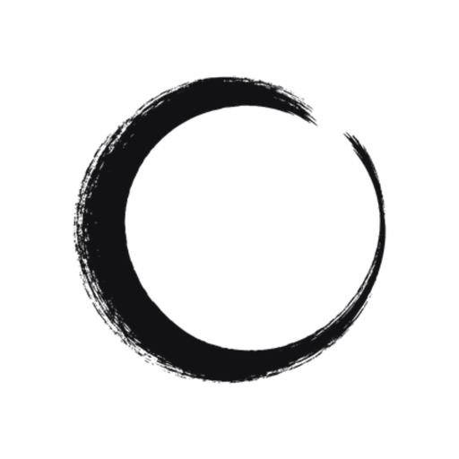

# Sumi app icon



The desktop icon set (`sumi-1024.png`, `sumi-512.png`, `sumi-256.png`, `sumi.ico`, and
`hicolor/{16..512}x.../apps/sumi.png`) presents the Sumi enso mark centered on a white rounded
tile (`rx = 224` at `1024×1024`).

The desktop icon generator lives in `tools/app-icon/make_icon.py`.

## Files

| File | What |
|---|---|
| `sumi-1024.png`, `sumi-512.png`, `sumi-256.png` | the icon on its rounded tile (desktop window, Linux menus, docs) |
| `sumi.ico` | multi-resolution Windows ICO container built from `hicolor/{16..256}` PNGs |
| `hicolor/<n>x<n>/apps/sumi.png` | FreeDesktop hicolor theme icons packaged for Linux |

## Regenerate

```
python tools/app-icon/make_icon.py
```
